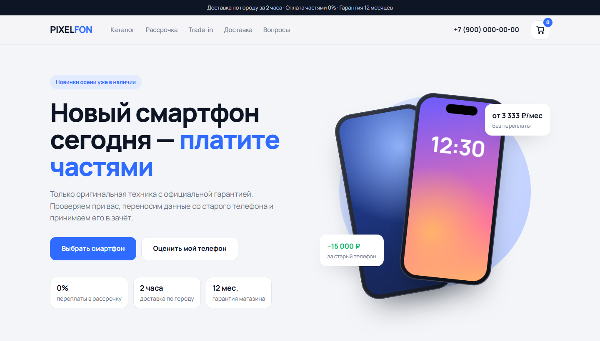

# PIXELFON — лендинг магазина смартфонов

**[Открыть сайт →](https://mahn1.github.io/smartphone-store-landing/)**

Продающая страница магазина смартфонов: каталог с корзиной, калькулятор рассрочки и оценка телефона по trade-in. Светлый «чистый» стиль.

## Что внутри

- **Каталог** генерируется из массива товаров: фильтр по бренду, сортировка по популярности и цене
- **Иллюстрации телефонов** нарисованы в SVG кодом — цвет корпуса и модуль камер задаются в данных товара
- **Корзина** в выезжающей панели: добавление, удаление, итоговая сумма, уведомления
- **Калькулятор рассрочки**: ползунок цены и срок, 0% до 12 месяцев, аннуитет на 24 месяца
- **Оценка trade-in** по бренду, году и состоянию телефона
- **Форма подбора** с проверкой полей
- Адаптивная вёрстка и мобильное меню

## Стек

HTML5 · CSS3 · чистый JavaScript без библиотек · Google Fonts (Manrope)

## Запуск

Сборка не нужна: откройте `index.html` в браузере.

---

Демо-проект для портфолио: магазин и контакты вымышлены, цены условные, заказы никуда не отправляются.
